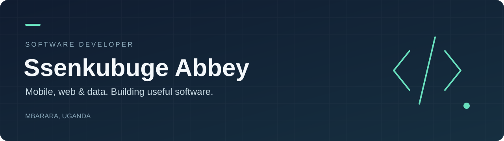

  

  <a href="#featured-projects">Featured projects</a> ·
  <a href="#selected-work">Selected work</a> ·
  <a href="PROJECTS.md">All projects</a> ·
  <a href="https://www.youtube.com/@abbeyssenkubuge">YouTube</a>

# Hi, I'm Abbey

I'm **Ssenkubuge Abbey** — a **software developer, data analyst, and teaching assistant** based in **Mbarara, Uganda**, and a graduate of **Mbarara University of Science and Technology**. I build mobile apps, web platforms, and data tools that solve real problems.

I turn data into useful decisions, help learners grow their technical confidence, and build products for collaborative learning, community reporting, job discovery, and data exploration.

## Working with

  
  
  
  
  
  
  
  

  
  
  
  
  
  
  

## Featured projects

### [DevFollow - A coding community for students](https://github.com/Abbey055/DevFollow)

A place for students to ask programming questions, share solutions, and build confidence together. Includes coding posts, comments, follows, real-time chat, and user profiles.

**Built with:** React, Vite, Chakra UI, Firebase Authentication, and Firestore.

[Explore the repository](https://github.com/Abbey055/DevFollow) · [Project website](https://devfellowmust.web.app)

### [CivicWatch - Community issue reporting](https://github.com/Abbey055/civicwatch)

An Android app that helps communities report local issues with photos, locations, categories, and progress updates. It makes community needs easier to see, track, and act on.

**Built with:** Java, Android, Firebase, and Google Maps.

[Explore the repository](https://github.com/Abbey055/civicwatch)

## Selected work

| Project | What it does | Built with |
| :--- | :--- | :--- |
| **[JobAnalyser](https://github.com/Abbey055/jobanalyser)** | Helps job seekers understand job posts and prepare applications, with Luganda translation. | Kotlin, Supabase, Groq |
| **[CivicWatch](https://github.com/Abbey055/civicwatch)** | Lets communities report local issues using photos, maps, and progress tracking. | Java, Android, Firebase |
| **[VeloceAI](https://github.com/Abbey055/veloceAi)** | Explores CSV and Excel data with SQL, interactive charts, and an AI assistant. | Python, Streamlit, DuckDB, Plotly |
| **[Faculty Voting System](https://github.com/Abbey055/evotingSystem)** | Supports faculty elections with voter verification and a guided ballot. | React, Supabase, serverless APIs |
| **[Java & PostgreSQL Assessment](https://github.com/Abbey055/servspace-technical-assessment)** | Implements an algorithm, a concurrent job queue, and a banking transfer service. | Java 17, Maven, PostgreSQL |

**More to explore:** [JobDecode](https://github.com/Abbey055/Jobdecode) · [Event Tracker](https://github.com/Abbey055/event-tracker) · [Zalseef Estates](https://github.com/Abbey055/zalseefestatesmbarara) · [React assessment projects](https://github.com/Abbey055/ServiceCops-Assessment-2026)

## Tools I work with

| Area | Technologies used in my projects |
| :--- | :--- |
| Mobile | Android, Java, Kotlin, Flutter, Dart |
| Web | React, JavaScript, Vite, HTML, CSS |
| Data & backend | Python, SQL, PostgreSQL, DuckDB, Firebase, Supabase |
| Development | Git, GitHub, Android Studio, Maven, Streamlit |

## Explore my projects

Browse the **[complete project directory →](PROJECTS.md)** for mobile apps, websites, AI and data tools, technical assessments, and learning projects.

## Connect

  
  

